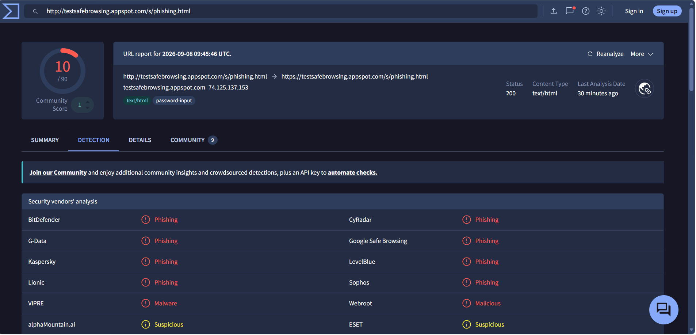
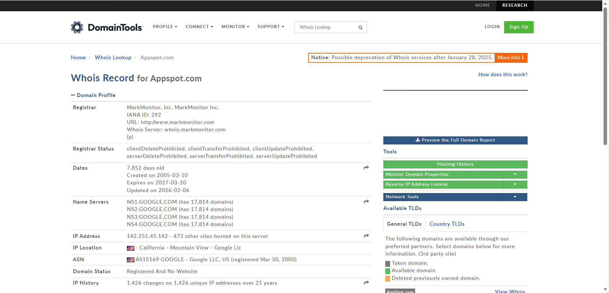
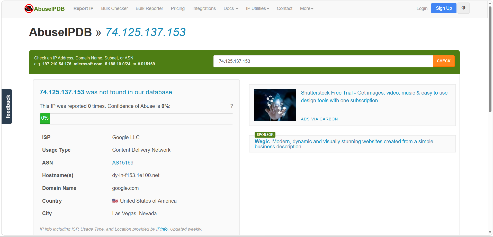
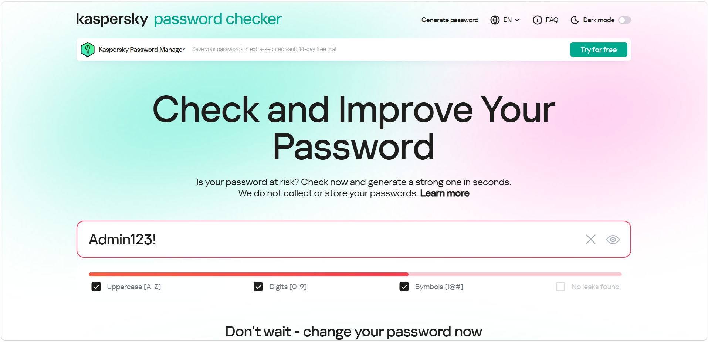
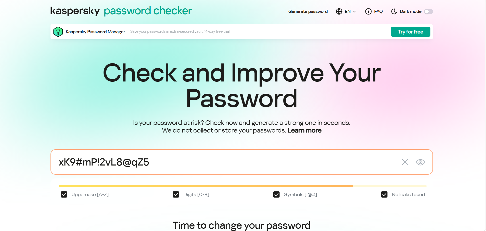

# SOC Incident Report: Threat Intelligence & Phishing Triage Lab

## Executive Summary
This report documents a Tier-1 SOC analyst triage procedure for suspicious domain, IP, and URL artifacts, alongside password policy security assessments. The goal of this investigation is to evaluate external threat intelligence tools (VirusTotal, WHOIS, AbuseIPDB) to determine threat levels, defang Indicators of Compromise (IOCs), and recommend appropriate SOC remediation steps.

---

## Technical Stack & Tools Used
* **Threat Intelligence & Scanning:** VirusTotal, WHOIS Lookup, AbuseIPDB
* **Security Testing:** Kaspersky Password Checker
* **Methodology:** IOC Defanging, Domain Analysis, IP Reputation Assessment, Password Policy Evaluation

---

## Task 1: URL Threat Analysis (VirusTotal)

### 1. Analysis Overview
* **Target Artifact:** http://testsafebrowsing.appspot.com/
* **Defanged Indicator:** http[:]//testsafebrowsing[.]appspot[.]com/
* **Analyst Findings:** The target URL was submitted to VirusTotal to cross-reference global vendor security databases. The scan results evaluate whether the domain is associated with known phishing campaigns, malware delivery, or malicious redirects.

### 2. Evidence

*Figure 1: VirusTotal Detection Tab showing vendor security verdicts and overall detection ratio.*

---

## Task 2: Domain & IP Reputation Inspection

### 1. WHOIS Domain Registration Lookup
* **Target Domain:** appspot.com
* **Analyst Findings:** A WHOIS lookup was performed to analyze domain ownership, registration age, update timestamps, and registrar details. Legitimate domains generally display established registration histories, whereas newly registered domains (NRDs) often correlate with malicious phishing infrastructure.

*Figure 2: WHOIS Lookup details displaying domain registrar and creation timestamps.*

---

### 2. AbuseIPDB IP Reputation Check
* **Target IP Address:** 74.125.137.153 (Google Infrastructure / AppEngine)
* **Analyst Findings:** The IP address resolved from the target domain was checked against AbuseIPDB's database to review recent report histories, confidence-of-abuse scores, and ISP origin. 

*Figure 3: AbuseIPDB IP reputation report showing confidence score and reported malicious activity history.*

---

## Task 3: Credential Security & Password Strength Testing

### 1. Policy Testing Overview
Password entropy and brute-force resistance were evaluated using Kaspersky Password Checker. The objective was to demonstrate the differential cracking time between weak, common credentials and high-entropy passphrases.

### 2. Weak Password Evaluation
* **Test Input:** Admin123!
* **Assessment:** Low entropy, vulnerable to dictionary attacks and automated brute-force attempts due to predictable word patterns.

*Figure 4: Kaspersky Password Checker demonstrating short estimated cracking time and potential exposure risks for a weak password.*

---

### 3. Strong Password Evaluation
* **Test Input:** xK9#mP!2vL8@qZ5
* **Assessment:** High entropy combining uppercase letters, lowercase letters, numbers, and special symbols. Highly resistant to offline dictionary and brute-force attacks.

*Figure 5: Kaspersky Password Checker demonstrating high resistance and extended crack duration for a complex passphrase.*

---

## SOC Recommendations & Remediation

1. **Phishing Defense:** Block confirmed malicious URLs at the email gateway and edge firewall levels.
2. **Endpoint Security:** Implement Automated URL Sandboxing for incoming email attachments and external links.
3. **Identity & Access Management (IAM):**
   * Enforce minimum 14-character passphrase policies across all user accounts.
   * Mandate Multi-Factor Authentication (MFA) to mitigate credential stuffing and password-spraying attacks.
